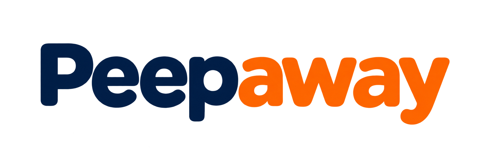

  

    
     
    <strong>Plan your next Trip with Friends & Stay Connected</strong>
  

  <a href="https://peepaway.com"><strong>Peepaway</strong></a>
  is an open-source travel planning platform built around a simple idea:
  planning and exploring the world shouldn't require another subscription.

    
  
  
  
  
  
  
  

#  Plan Better, Explore More

---

##  Features

-  Select airport you could travel from *(planned)*
-  Email alerts for deal matches *(planned)*
- Uh not sure... I will add things as I go
- More features will be added as the project evolves.

---

##  Why I Built This

I was bored and wanted to learn:
- How travel deal engines work under the hood
- How to build and scale scraping-based APIs
- How to build backend and design systems

The backend for this project isn't included in this repo. ()

---

## Getting Started

Peepaway is under active development, and the setup process is still evolving.

Installation instructions and local development documentation will be added as the application takes shape.

### Help The Community

Fun fact: Peepaway welcomes contributions!

Read our [Contributing Guidelines](CONTRIBUTING.md)
to learn how to get involved.

